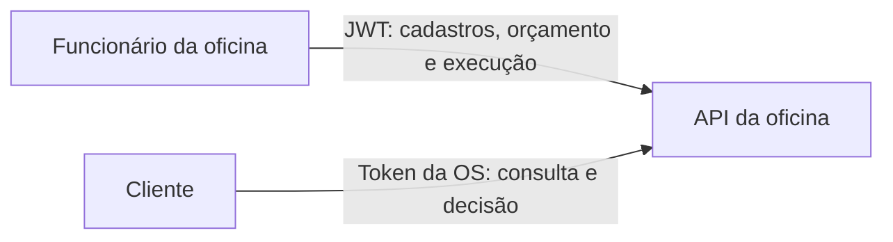
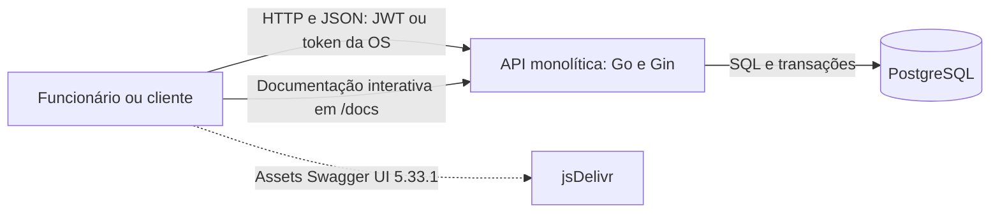
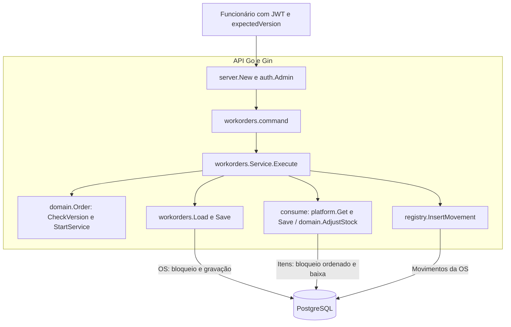
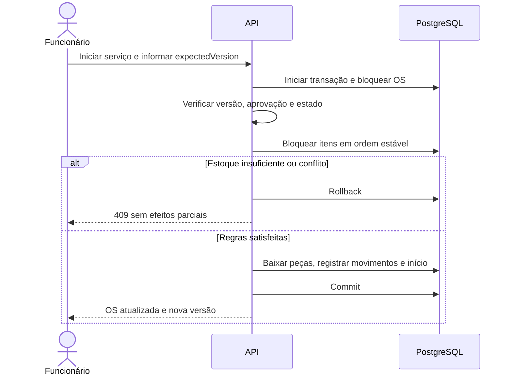

# Arquitetura da API

Este documento descreve a implementação da API da oficina. As regras completas estão na [especificação](especificacao.md).

## C4 nível 1 - Contexto



O funcionário controla a operação. O cliente acessa apenas a OS associada ao seu token. Não há dependência de sistemas de pagamento ou mensageria externa nesta fase.

## C4 nível 2 - Contêineres



São uma aplicação Go monolítica e um banco PostgreSQL 18. O próprio backend serve `/docs` e o contrato estático `/openapi.yaml`. Swagger carrega CSS e JavaScript de `swagger-ui-dist` 5.33.1 via CDN; esses assets precisam de internet. As chamadas da API e o contrato permanecem locais. HTTP é aceitável em localhost; uma publicação externa deve terminar HTTPS no servidor web ou proxy.

Docker Compose configura a API, o banco e uma tarefa de carga inicial (`seed`). A configuração foi validada, mas a execução dos contêineres permanece pendente porque o daemon Docker local não iniciou. A integração foi executada diretamente contra PostgreSQL 18.6.

Na execução nativa, `HOST` é `127.0.0.1` por padrão, limitando o acesso ao próprio computador. No contêiner, `HOST=0.0.0.0` permite receber tráfego do Docker; a porta publicada pelo Compose continua vinculada a `127.0.0.1` no host.

## C4 nível 3 - Início do primeiro serviço

O recorte de componentes acompanha o início do primeiro serviço da OS. O backend valida o acesso administrativo e a versão, aplica as regras de execução e persiste OS, estoque e movimentos na mesma transação.



Falhas desfazem a transação; os próximos serviços não repetem a baixa. As imagens dos três níveis, o mapeamento dos componentes para o código e os PDFs estão em [C4 da oficina](ddd/c4.md).

## Responsabilidades do backend

| Camada | Responsabilidade | Exemplo |
|---|---|---|
| HTTP | Autenticar, validar formato, traduzir requisições e erros | Handler de aprovação |
| Aplicação | Coordenar caso de uso, persistência e transação | Iniciar primeiro serviço e baixar peças |
| Domínio | Aplicar regras independentes de framework | Transições válidas, cálculo de orçamento |
| Persistência | Consultar e gravar usando PostgreSQL | Repositório de OS e movimentos |

As funcionalidades ficam próximas no código; a separação de camadas não exige quatro diretórios em todos os módulos. A interface `platform.DB` permite usar as mesmas consultas com conexão ou transação. As operações do domínio recebem seus dados e horários explicitamente, sem depender de Gin ou PostgreSQL.

Estrutura implementada:

```text
backend/
  cmd/api/
  cmd/seed/
  internal/
    auth/
    domain/
    registry/
    workorders/
    platform/
    server/
  migrations/
  tests/
docs/
  api/
  ddd/
  decisions/
```

`domain` contém regras de OS, orçamentos, valores e documentos. `registry` trata clientes, veículos, catálogo e estoque. `workorders` reúne os casos de uso da OS, persistência e indicadores. `auth` fornece autenticação, tokens e limites de tentativas; `platform` contém conexão, contrato de acesso ao banco e utilitários HTTP. `server` compõe rotas, configuração, CORS, saúde e Swagger. `migrations` executa o SQL versionado.

## Persistência e integridade

O acesso usa SQL explícito com `pgx`, sem ORM. Cada cadastro e o agregado completo da OS ficam em uma coluna `data` JSONB. Serviços da OS, versões de orçamento, histórico e snapshots compõem o documento da OS. Administradores e movimentos de estoque possuem tabelas próprias; os movimentos mantêm referências ao item e à OS.

Colunas geradas extraem documento, placa, SKU, referências, número, status e versão quando necessário. O banco aplica `UNIQUE`, chaves estrangeiras e `CHECK`, além de índices para consultas e uma restrição que impede repetir o consumo de um item pela mesma OS. As regras internas dos documentos e a validação das referências de itens também são protegidas pela aplicação.

Essa persistência híbrida é proporcional ao MVP: simplifica leitura e gravação do agregado, mantendo transações e restrições relacionais nos vínculos principais. O custo é regravar documentos completos e consultar arrays JSONB nos indicadores; o modelo não oferece todas as garantias de um esquema totalmente normalizado. Maior volume, relatórios complexos ou atualizações independentes de itens podem justificar normalização posterior.

## Contrato e autorização

As 40 operações documentadas seguem `docs/api/openapi.yaml`. A autorização é aplicada no backend: JWT nas rotas administrativas e token opaco restrito a uma OS nas rotas do cliente, ambos no cabeçalho `Authorization: Bearer`. Somente o hash do token de cliente é persistido. Swagger desativa persistência da autorização, usa o contrato local e restringe recursos por Content Security Policy.

## Transação principal



A baixa se aplica apenas ao primeiro serviço iniciado. Os demais serviços iniciam sem nova movimentação de peças.

## Decisões

As decisões iniciais e os respectivos custos estão registradas em [Decisões da fase 1](decisions/0001-fundamentos.md). A documentação DDD descreve os limites conceituais do negócio, que podem reunir mais de um módulo de código.
