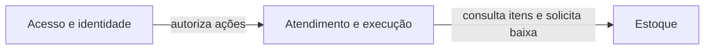

# Domínio da oficina

Modelo conceitual construído para este projeto com base na [especificação do sistema](../especificacao.md), acompanhado de implementação e testes das invariantes descritas abaixo. Não representa um workshop realizado com especialistas da oficina.

## Linguagem ubíqua

| Termo | Significado no MVP |
|---|---|
| Cliente | Pessoa física ou jurídica responsável pelo veículo e pela decisão sobre o orçamento. |
| Funcionário | Pessoa autenticada que realiza as operações administrativas da oficina. Há um único perfil administrativo. |
| Veículo | Veículo identificado por placa única e vinculado a um cliente. |
| Serviço do catálogo | Definição reutilizável de um serviço, com nome e preço atual. |
| Item de serviço da OS | Uma execução de um serviço do catálogo naquela OS; tem identidade, estado e horários próprios. Não possui quantidade. |
| Peça / insumo | Item de estoque classificado como `PART` ou `SUPPLY`, movimentado em unidades inteiras. |
| Ordem de serviço (OS) | Registro do atendimento, do problema relatado, dos itens solicitados e de seu andamento. |
| Diagnóstico | Etapa na qual o funcionário define ou revisa serviços e peças necessários. |
| Orçamento | Versão dos serviços e peças, com nomes, preços, quantidades e total congelados para decisão do cliente. |
| Orçamento vigente | Última versão da OS que pode orientar a decisão ou a execução; uma versão superada não volta a produzir efeitos. |
| Aprovação | Aceite do orçamento vigente pelo cliente. Não inicia a execução nem reserva estoque. |
| Rejeição | Recusa do orçamento vigente; devolve a OS ao diagnóstico. Não cancela a OS. |
| Reabertura do diagnóstico | Ação anterior à execução que supera o orçamento pendente ou aprovado e exige novo orçamento e nova aprovação. |
| Baixa | Saída de todas as peças aprovadas, uma única vez, ao iniciar o primeiro serviço. |
| Movimento de estoque | Registro explícito de entrada ou saída com quantidade assinada e motivo; pode referenciar a OS. |
| Finalização | Encerramento técnico da OS após concluir todos os seus serviços. |
| Entrega | Registro de devolução do veículo, posterior à finalização. |
| Token de acesso à OS | Credencial limitada a uma OS, enviada como Bearer na API e com validade; não é uma busca pública por documento ou placa. |
| Tempo de execução | Intervalo entre início e conclusão de um serviço, ou entre início da execução e finalização da OS; exclui diagnóstico e espera por aprovação. |

## Candidatos a contextos delimitados

Os limites abaixo são hipóteses de modelagem para um monólito com PostgreSQL. Não implicam microsserviços, bancos separados ou mensageria. Os módulos de código podem separar funcionalidades dentro de um mesmo contexto.

| Contexto candidato | Responsabilidade e justificativa | Relação com os módulos implementados |
|---|---|---|
| Atendimento e execução da oficina | Concentra o significado de OS, diagnóstico, orçamento, decisão e execução. Esses conceitos compartilham o mesmo ciclo de vida e regras que precisam permanecer coerentes. | `domain`, `workorders` e cadastros em `registry`. No MVP, não há evidência de linguagem ou regras autônomas que justifiquem um contexto para cada cadastro. |
| Estoque | Controla unidades disponíveis, tipos de item e movimentos. Uma aprovação pertence ao atendimento e não significa reserva no vocabulário de estoque. Seu saldo tem regras próprias de integridade. | Estoque em `registry`, coordenado por `workorders` no início da execução. O atendimento usa a identificação do item e seu preço para montar o orçamento. |
| Acesso e identidade | Autentica funcionários e limita o acesso do cliente à OS concedida. A identidade de acesso não se confunde com o cadastro comercial de cliente. | `auth` e emissão/validação da credencial em `workorders`. É uma capacidade de apoio; JWT e hash do token são escolhas técnicas, não entidades centrais do negócio. |

O contexto de atendimento consulta cadastros e preços para montar o orçamento e preserva os valores aprovados em snapshots. Acesso autoriza a ação antes do caso de uso de negócio. Atendimento e estoque cooperam no início do primeiro serviço por uma transação local; o limite conceitual não exige consistência eventual.

## Entidades, objetos de valor e agregados propostos

Uma entidade tem identidade e continuidade. Um objeto de valor é definido pelos seus valores e validações. O agregado delimita as alterações que uma raiz deve proteger; não é sinônimo de tabela ou de contexto.

| Raiz de agregado candidata | Entidades e objetos de valor | Regras sob sua responsabilidade |
|---|---|---|
| Ordem de serviço | Raiz OS; entidades Item de serviço e Orçamento versionado. Itens de peça e linhas congeladas do orçamento podem ser objetos de valor, identificados por suas referências e conteúdo. Estados, quantidades e valores monetários são objetos de valor. | Proteger o ciclo de vida, as listas de itens, a versão de concorrência, o orçamento vigente e a execução dos serviços. Orçamentos têm UUID e histórico, mas não precisam ser agregados independentes: suas decisões alteram a OS. |
| Item de estoque | Raiz com UUID, SKU, tipo, preço, saldo e atividade. Movimento é uma entidade histórica com UUID, quantidade assinada, motivo e referência opcional à OS. | Garantir movimento e saldo coerentes, saldo não negativo e impossibilidade de editar saldo diretamente. O histórico de movimentos não precisa ser carregado inteiro para alterar a raiz. |
| Cliente | Raiz com UUID; documento normalizado, nome e contatos. | Manter documento válido, identidade cadastral e atividade. A unicidade global exige persistência, além da validação local. |
| Veículo | Raiz com UUID; referência ao cliente, placa normalizada, marca, modelo e ano. | Manter identificação e vínculo cadastral. A criação da OS verifica o vínculo com o cliente informado. |
| Serviço do catálogo | Raiz com UUID; nome, descrição, preço e atividade. | Manter preço válido e disponibilidade para novas inclusões. Alterar preço do catálogo não recalcula orçamento já publicado. |

Documento, placa e dinheiro são valores do modelo, representados no código por `string` e `int64` e validados pelas funções `Document`, `Plate`, `AddMoney` e `MultiplyMoney`. Quantidades e estados também usam tipos básicos com validações de domínio. `VehicleSnapshot` preserva a identificação histórica do veículo. Identificadores referenciam outras raízes sem exigir um grafo carregado em memória. Motivos de movimento são obrigatórios; não há taxonomia fechada definida no design.

CPF/CNPJ e placa seguem as regras de validação e normalização do design, incluindo a coexistência dos formatos numérico e alfanumérico do CNPJ. Documentos são strings e a normalização preserva as letras do CNPJ.

A implementação grava o agregado de OS, incluindo itens, orçamentos e histórico, em JSONB. Os cadastros também usam JSONB, com colunas geradas e restrições relacionais nos vínculos principais. Movimentos de estoque são registros separados. Essa escolha de persistência não altera os limites conceituais dos agregados; a baixa exige coordenação transacional entre OS e estoque. A justificativa e os custos estão na [arquitetura](../arquitetura.md).

## Invariantes

### Abertura, itens e histórico

- A OS nasce em `RECEIVED`, com número sequencial legível e vínculo entre cliente e veículo consistente. Cadastros inativos não entram em novas OS.
- A abertura preserva `customerId` e `vehicleId` originais e congela nome do cliente, placa, marca, modelo e ano do veículo. Alterações cadastrais posteriores não reescrevem esses snapshots nem mudam o cliente das OS anteriores.
- Transferir um veículo para outro cliente exige que todas as OS desse veículo estejam `DELIVERED`; caso contrário, a atualização retorna 409. A verificação envolve o caso de uso e a persistência das OS relacionadas, não apenas a entidade Veículo isolada.
- Serviço não se repete na mesma OS e representa uma única execução, com UUID estável. Item de peça não se repete e possui quantidade inteira positiva.
- Substituir a lista completa de serviços e peças só é permitido em `RECEIVED` ou `IN_DIAGNOSIS`. Publicar orçamento exige pelo menos um serviço e preços válidos.
- Valores monetários são inteiros em centavos de BRL e o total é calculado pelo servidor. Orçamento publicado preserva nomes, preços e quantidades; seu histórico não é apagado pela revisão.
- Desativação é lógica e mantém documento, placa e SKU únicos. OS existentes permanecem legíveis. A edição pode reativar cadastros.

### Orçamento e decisão

- Cada orçamento recebe versão sequencial por OS. Publicação cria `PENDING` e move a OS para `AWAITING_APPROVAL`.
- Só o orçamento vigente e `PENDING` recebe uma nova decisão. Aprovar produz `APPROVED`, mantendo a OS em `AWAITING_APPROVAL`; rejeitar produz `REJECTED` e devolve a OS a `IN_DIAGNOSIS`.
- Repetir a mesma decisão sobre o mesmo orçamento é idempotente somente enquanto ele continuar vigente. Decisão diferente ou versão superada gera conflito.
- Reabrir diagnóstico de `AWAITING_APPROVAL`, antes de qualquer início de serviço, torna o orçamento pendente ou aprovado `SUPERSEDED`. A próxima publicação exige nova aprovação.
- Não há acréscimos de serviços/peças após o início da execução nem cancelamento de OS neste MVP.

### Execução e estoque

- O primeiro serviço exige aprovação vigente e disponibilidade de todas as peças. Aprovar não reserva saldo.
- Baixa de todas as peças, movimentos, início do serviço e mudança da OS para `IN_EXECUTION` acontecem juntos ou não acontecem. O saldo nunca fica negativo e a baixa não se repete ao iniciar os demais serviços.
- Serviços podem executar em paralelo. Somente um serviço `IN_PROGRESS` pode ser concluído; a conclusão registra seu horário.
- Todos os serviços devem estar `COMPLETED` antes da finalização da OS. A entrega ocorre apenas após a finalização.
- Quantidade inicial, reposição e ajuste são movimentos explícitos; motivo é obrigatório. Não existe alteração direta do saldo por edição cadastral.

A operação de primeiro início atravessa a OS e os itens de estoque. Essa é uma garantia do caso de uso com transação PostgreSQL, bloqueio da OS e dos itens em ordem estável; não se presume que tudo pertença a um único agregado. Alterações administrativas de OS verificam `expectedVersion` antes de efeitos. Repetir início de serviço já iniciado resulta em conflito e não gera nova baixa.

### Consulta e acesso

- Consultar a OS não muda seu estado. O cliente só recebe dados necessários à OS autorizada, sem CPF/CNPJ ou dados administrativos.
- Somente o token mais recente da OS é válido; a validade padrão é de 30 dias, configurável. Consulta por documento ou placa não concede acesso.
- Transferir o veículo não amplia o escopo dos tokens existentes: eles continuam restritos às respectivas OS originais e não concedem acesso ao novo proprietário.
- Datas são persistidas e transmitidas pela API em UTC/RFC 3339.
- Indicadores incluem somente serviços concluídos e OS finalizadas no intervalo definido no design. Sem amostras, a média é `null` e a contagem é zero.

## Validação do modelo

Os testes unitários exercitam o cálculo de orçamento, transições e validações. Testes de integração com PostgreSQL 18.6 verificam revisão e aprovação, concorrência, isolamento de acesso, snapshots e rollback de estoque. Essas verificações dão evidência técnica das invariantes, mas não substituem uma validação do modelo com especialistas do negócio. Os limites dos contextos continuam sendo decisões conceituais do projeto.

## Evidências e entrega

Este Markdown e [Event Storming](event-storming.md) registram a modelagem conceitual. A evidência de execução está em [Requisitos e evidências](../entrega-fase-1.md). As exportações estão disponíveis em [C4 em PDF](exports/c4.pdf), [Event Storming em PDF](exports/event-storming.pdf) e nas imagens da pasta [exports](exports/).
