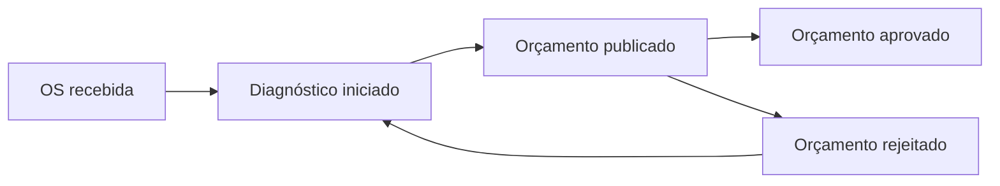
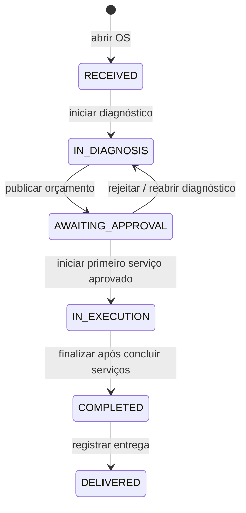

# Event Storming da oficina

Modelagem conceitual baseada na [especificação do sistema](../especificacao.md). Este registro organiza os fluxos do domínio; não representa uma sessão de validação com especialistas da oficina. Os limites e termos complementares estão em [Domínio](dominio.md).

Comando expressa uma intenção; evento descreve um fato de negócio no passado; política registra uma condição ou consequência do fluxo. As políticas abaixo podem ser executadas pelo próprio caso de uso síncrono. Os eventos não exigem event bus, processamento assíncrono, event sourcing ou tabelas de eventos. Histórico de orçamento, andamento e movimentos continua necessário conforme o design, independentemente da técnica de persistência.

## Criação e preparação da OS

| Ator | Comando | Evento conceitual | Política / condição |
|---|---|---|---|
| Funcionário | Cadastrar cliente | Cliente cadastrado | Normalizar e validar documento; preservar sua unicidade, inclusive entre inativos. |
| Funcionário | Cadastrar veículo | Veículo cadastrado | Vincular ao cliente e validar placa única. |
| Funcionário | Abrir OS | OS recebida | Cliente e veículo devem estar ativos e vinculados entre si. Criar número legível, estado `RECEIVED` e itens opcionais sem duplicatas. Preservar IDs originais e congelar nome do cliente, placa, marca, modelo e ano do veículo. |
| Funcionário | Atualizar cadastro de cliente ou veículo | Cadastro atualizado | Alterações não reescrevem os snapshots das OS anteriores. CPF/CNPJ e placa seguem as regras de validação e normalização do design, incluindo o CNPJ alfanumérico. |
| Funcionário | Transferir veículo para outro cliente | Veículo transferido | Exigir todas as OS do veículo em `DELIVERED`; caso contrário, retornar 409. Preservar cliente original das OS anteriores e restringir tokens existentes às respectivas OS originais, sem conceder acesso ao novo proprietário. |
| Funcionário | Iniciar diagnóstico | Diagnóstico iniciado | OS em `RECEIVED` passa para `IN_DIAGNOSIS`. |
| Funcionário | Substituir serviços e peças da OS | Itens da OS definidos | Aceitar listas completas somente em `RECEIVED` ou `IN_DIAGNOSIS`; validar quantidades e referências. |
| Funcionário | Publicar orçamento | Orçamento publicado | Exigir ao menos um serviço; congelar nomes, preços e quantidades; calcular total; criar versão `PENDING` e mover OS para `AWAITING_APPROVAL`. |
| Funcionário | Emitir ou substituir acesso do cliente | Acesso à OS emitido | Escopo de uma OS, validade configurável e somente token mais recente válido. O funcionário disponibiliza o token, que o cliente envia como Bearer na API; não há envio externo automatizado. |

## Decisão, execução e acompanhamento

| Ator | Comando ou consulta | Evento conceitual | Política / condição |
|---|---|---|---|
| Cliente autorizado | Consultar andamento e orçamento | Nenhum evento de negócio exigido | Retornar pela API a visão restrita da OS e histórico. A consulta não produz transição. |
| Funcionário | Consultar OS | Nenhum evento de negócio exigido | Retornar a situação atual; ações específicas validam o estado, sem permitir alteração livre do status. |
| Cliente autorizado | Aprovar orçamento vigente | Orçamento aprovado | Decidir pelo UUID do orçamento vigente `PENDING`; OS permanece `AWAITING_APPROVAL`. Não reservar estoque nem iniciar serviços. |
| Cliente autorizado | Rejeitar orçamento vigente | Orçamento rejeitado | Decidir pelo UUID vigente `PENDING`; orçamento passa a `REJECTED` e OS retorna a `IN_DIAGNOSIS`. |
| Funcionário | Reabrir diagnóstico | Orçamento superado; diagnóstico reaberto | Permitido de `AWAITING_APPROVAL` antes de iniciar qualquer serviço. Tornar orçamento pendente ou aprovado `SUPERSEDED`; voltar a `IN_DIAGNOSIS`. |
| Funcionário | Iniciar primeiro serviço | Peças baixadas, quando houver peças; serviço iniciado; execução da OS iniciada | Exigir orçamento vigente aprovado. Na mesma transação, verificar saldo, baixar todas as peças aprovadas, registrar movimentos, iniciar serviço e mover OS para `IN_EXECUTION`. Falha desfaz tudo. |
| Funcionário | Iniciar outro serviço | Serviço iniciado | Com execução em andamento, iniciar serviço ainda não iniciado. Não baixar peças novamente. Vários serviços podem ficar `IN_PROGRESS`. |
| Funcionário | Concluir serviço | Serviço concluído | Somente de `IN_PROGRESS` para `COMPLETED`, registrando término. |
| Funcionário | Finalizar OS | OS finalizada | Todos os serviços devem estar concluídos; registrar finalização e estado `COMPLETED`. A conclusão do último serviço não substitui esta ação explícita. |
| Funcionário | Registrar entrega | OS entregue | OS finalizada passa para `DELIVERED`; a finalização permanece como marco do indicador de execução. |

Repetir a mesma decisão do cliente sobre o mesmo orçamento vigente é idempotente: não representa um segundo fato de negócio. Se a versão deixou de ser vigente, a repetição gera conflito. Decisão divergente também gera conflito. Alterações administrativas de OS recebem `expectedVersion`; versão desatualizada impede efeitos. Repetir início de serviço já iniciado é conflito, sem novo movimento de estoque.

Aprovar o orçamento altera seu estado para `APPROVED` e mantém a OS em `AWAITING_APPROVAL`. Essa combinação significa orçamento aprovado, aguardando início. Não há estado adicional de OS nem início automático decorrente da aprovação.

## Gestão do estoque

| Ator | Comando | Evento conceitual | Política / condição |
|---|---|---|---|
| Funcionário | Cadastrar item de estoque | Item de estoque cadastrado; movimento de abertura registrado | SKU único inclusive entre inativos; tipo `PART` ou `SUPPLY`; unidades inteiras, preço válido e saldo inicial não negativo registrado como movimento. |
| Funcionário | Repor estoque | Reposição registrada | Registrar entrada e motivo; atualizar saldo na mesma operação. |
| Funcionário | Ajustar estoque | Ajuste de estoque registrado | Registrar quantidade com sinal e motivo; impedir saldo final negativo. Não editar saldo por `PATCH` cadastral. |
| Caso de uso de início do primeiro serviço, acionado pelo funcionário | Baixar peças aprovadas | Movimentos de saída registrados; peças da OS baixadas | Baixa única de todos os itens da OS, vinculada à OS e atômica com o início. Bloquear itens em ordem estável para concorrência. |
| Funcionário | Atualizar preço ou dados do item | Item de estoque atualizado | Atualizar cadastro não altera orçamento já congelado nem movimenta saldo. |
| Funcionário | Desativar / reativar item | Item desativado / reativado | Exclusão lógica preserva histórico e unicidade do SKU; item inativo não entra em nova OS. |

Estoque insuficiente é recusa do comando de início, não um fato de execução bem-sucedida: não há baixa parcial, serviço iniciado nem mudança parcial de status. Uma reposição posterior permite ao funcionário tentar o início novamente; não há política de retomada automática proposta.

## Leituras e limites do modelo

- Criação usa as leituras de cliente, vínculo do veículo, catálogo e estoque; orçamento usa preços atuais para produzir snapshots.
- Acompanhamento usa estado da OS, orçamento vigente e histórico; o cliente tem acesso apenas à sua OS autorizada.
- Gestão de estoque usa saldo e movimentos; indicadores de execução usam horários de serviços concluídos e OS finalizadas conforme os intervalos do design.
- Autenticação e autorização antecedem os comandos. Token inválido/expirado ou acesso fora do escopo não gera transição de negócio.
- Não modelados nesta fase: pagamento, fiscal, reserva de estoque, compras a fornecedores, notificação real por email/WhatsApp, cancelamento ou acréscimos durante execução.

## Verificação e entrega

Os eventos descritos são nomes de modelagem, não mensagens de integração. O fluxo é implementado por casos de uso síncronos. Testes HTTP com PostgreSQL 18.6 verificam revisão e nova aprovação, decisão idempotente e conflitos, acesso isolado por OS, concorrência de início e rollback de estoque. Os resultados estão em [Requisitos e evidências](../entrega-fase-1.md). Exportação em PDF ou imagens, publicação pública e link compartilhável permanecem pendentes; este Markdown não os substitui.
